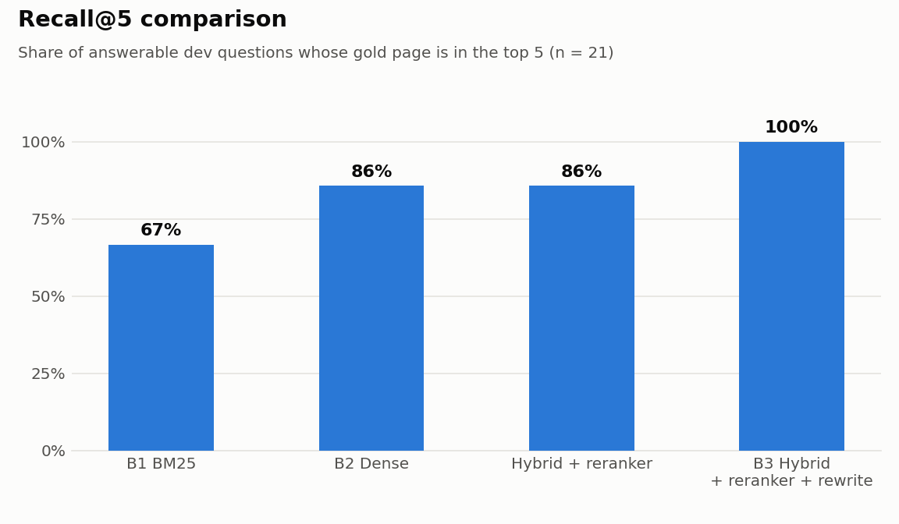

# 04 · Retrieval and reranking

Reproduce: `python -m eval.run_eval --configs B1 B2 A1-structure A2-hybrid A3-rerank B3 --split dev --retrieval-only`
(and `--split test`). Retrieval latency below excludes answer generation.

## Embedding and index
| | value |
|---|---|
| Model | `sentence-transformers/all-MiniLM-L6-v2` (sentence-transformers 6.1.0), 384 dims, max 256 tokens |
| Normalization | L2-normalized at encode time (`normalize_embeddings=True`); norms verified 1.000-1.000 |
| Distance | Chroma HNSW `space: cosine`; with unit vectors cosine = dot product, so metric and normalization match |
| Chroma embedding function | none: we pass our own vectors, so Chroma can never embed with a different model |
| Metadata | `doc_id, url, title, section, strategy, page_type, effective_date, fetched_at` |

## Retrievers (all three implemented and measured)
- **Dense:** query embedded with the same model, top-k from Chroma filtered by strategy.
- **BM25:** `rank_bm25.BM25Okapi` over a shared tokenizer that lowercases, normalizes
  degree abbreviations (`Ph.D.` -> `phd`) and applies light plural stemming
  (`courses` -> `course`). Before this, "PhD" never matched "Ph.D.".
- **Hybrid:** Reciprocal Rank Fusion, `score = Σ 1/(60 + rank)` over dense and BM25 lists
  of 40 each. Ranks only, so cosine (0-1) and BM25 (0-30) scales are never mixed.
- **Candidate pool:** 20 (requirement >= 20).
- **Metadata filtering:** `page_type` in {program, financial, admissions, policy, calendar,
  student-life, about, general}: a Chroma `where` clause for dense, a mask for BM25.
  Example "How much does it cost?": unfiltered top-4 includes International Students and
  Master's in Finance; with `--page-type financial` it returns Tuition and Cost of
  Attendance. UI: "Search only" selector.

## Results, development split (n = 21 answerable items with a gold page)
| Metric | B1 BM25 | B2 Dense (fixed) | Dense (structure) | Hybrid | Hybrid + reranker | B3 final |
|---|---|---|---|---|---|---|
| Recall@5 | 66.67% | 85.71% | 85.71% | 85.71% | 85.71% | 100% |
| Recall@20 | 85.71% | 85.71% | 90.48% | 90.48% | 90.48% | 100% |
| MRR | 0.5461 | 0.7460 | 0.7917 | 0.7532 | 0.7651 | 0.8810 |
| nDCG@10 | 0.5897 | 0.7609 | 0.8085 | 0.7735 | 0.7830 | 0.8793 |
| p50 latency | 4.4 ms | 27.7 ms | 27.9 ms | 34.3 ms | 93.7 ms | 99.8 ms |
| p95 latency | 11.2 ms | 30.2 ms | 32.8 ms | 43.4 ms | 109.8 ms | 1,530.7 ms |

## Results, test split (n = 14), run once at commit 060a636
| Metric | B1 BM25 | B2 Dense (fixed) | Dense (structure) | Hybrid | Hybrid + reranker | B3 final |
|---|---|---|---|---|---|---|
| Recall@5 | 92.86% | 78.57% | 100% | 100% | 100% | 100% |
| Recall@20 | 92.86% | 100% | 100% | 100% | 100% | 100% |
| MRR | 0.8393 | 0.7036 | 0.9286 | 0.9167 | 1.0000 | 1.0000 |
| nDCG@10 | 0.8554 | 0.7652 | 0.9261 | 0.9356 | 1.0000 | 1.0000 |
| p50 latency | 5.5 ms | 26.4 ms | 27.7 ms | 33.8 ms | 94.2 ms | 93.9 ms |
| p95 latency | 9.1 ms | 28.2 ms | 29.7 ms | 42.0 ms | 115.6 ms | 102.5 ms |

## Reranker (cross-encoder/ms-marco-MiniLM-L-6-v2, pool 20 -> top 5)
| | dev | test |
|---|---|---|
| Lift, hybrid -> hybrid + reranker: MRR | 0.7532 -> 0.7651 (+0.012) | 0.9167 -> 1.0000 (+0.083) |
| Lift: nDCG@10 | 0.7735 -> 0.7830 (+0.010) | 0.9356 -> 1.0000 (+0.064) |
| Lift: answer correct (all items, paired) | 0.91 -> 0.88 (-0.03 [-0.15, +0.06], p = 1.00) | 0.82 -> 1.00 (+0.18 [+0.00, +0.35], p = 0.25) |
| Added latency (p50) | +59 ms (34 -> 94 ms) | +60 ms (34 -> 94 ms) |
| **Pool ceiling: Recall@20 of the hybrid pool** | 0.90 | 1.00 |

The reranker can only reorder what the pool contains, so Recall@20 is its ceiling: on
dev, 2 of 21 gold pages never reach the 20-candidate pool without rewriting. The
reranker's other job is the refusal signal: its scores are comparable across queries
(relevant ~ +1..+9, off-topic ~ -10), which RRF scores are not.

Known reranker behaviour: it prefers prose that *reads like* an answer over a bare list
(the PhD-in-IT course list scored <= 5.1 vs 7.96 for a program summary). Section
expansion (report 05) works around this.

## Query rewriting (B3 only, fallback)
When stage 8 would refuse, Claude rewrites the question into <= 3 website-vocabulary
queries ("billing ... escalate" -> "Student Financial Center contact"); results are fused
by RRF and reranked with the best score over question + rewrites.
- Rewriting *every* question: answer correct 0.92 -> 0.83 (2 fixes, 5 regressions on exact
  terms such as "KCTCS ENG 101"). Rejected.
- Fallback only (dev): Recall@5 0.86 -> 1.00 (retrieval-only), false refusals 0.14 -> 0.05;
  accepted. Cost: p95 latency 1.5 s when it triggers; it can lift an off-topic question
  past stage 8 (Super Bowl scored 4.12 once), which stage 9 then refuses.
