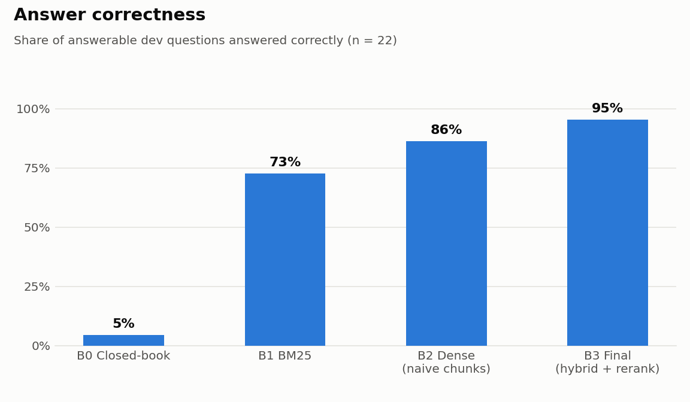

# 06 · Final performance

**The test split was run exactly once**, with the configuration frozen at commit
`060a636` of the development repository (where the pipeline was built before it was
moved stage by stage into the team repository; the pipeline code is identical), on
2026-10-10 20:46 UTC (`eval/results/TEST_RUN_COMMIT.txt`). All tuning
(rewrite fallback, section expansion, thresholds) used the dev split only. Caveat
(report 03): test items were seen during development but not used for any decision.
**Changed after the test run:** a rewrite-parsing bug (the model's commentary line, e.g.
"I can't say that tuition is free...:", was used as a search query) was fixed in
`compass/rewrite.py`; it only affects the rewrite fallback, which did not trigger on any
test item. All test numbers below come from the frozen commit.

Reproduce: `python -m eval.run_eval --configs B0 B1 B2 A1-structure A2-hybrid A3-rerank A4-expand B3 --split test`;
statistics `python -m eval.compare B0 B3 --split test` and
`python -m eval.compare --chain B2 A1-structure A2-hybrid A3-rerank A4-expand B3 --split test`.
Generation model for all configs: Claude Haiku 5.5.

## Headline (test, 17 items: 14 answerable, 3 unanswerable)
| Metric | B0 closed-book | B1 BM25 | B2 dense, naive chunks | **B3 final** |
|---|---|---|---|---|
| Recall@5 / Recall@20 | - | 0.93 / 0.93 | 0.79 / 1.00 | **1.00 / 1.00** |
| MRR / nDCG@10 | - | 0.84 / 0.86 | 0.70 / 0.77 | **1.00 / 1.00** |
| Answer correct (answerable) | 0.07 | 0.79 | 0.50 | **1.00** |
| Citation valid | - | 1.00 | 0.69 | **1.00** |
| Over-refusal (answerable) | 0.93 | 0.07 | 0.07 | **0.00** |
| Correct refusal (unanswerable) | 1.00 | 1.00 | 1.00 | **1.00** |
| PII leaked to LLM | 0/1 | 0/1 | 0/1 | **0/1** |
| p50 / p95 latency, end-to-end | 1.79 / 2.75 s | 1.88 / 3.36 s | 2.17 / 3.80 s | 2.05 / 3.49 s |
| Cost per query | $0.0001 | $0.0004 | $0.0004 | $0.0006 |

### Paired comparisons (all 17 items; 95% bootstrap CI, 10,000 resamples; McNemar exact)
| Comparison | Accuracy | Difference [95% CI] | Discordant (A only / B only) | McNemar p |
|---|---|---|---|---|
| B0 -> B3 | 0.24 -> 1.00 | **+0.76 [+0.53, +0.94]** | 0 / 13 | **< 0.001** |
| B2 -> B3 | 0.59 -> 1.00 | **+0.41 [+0.18, +0.65]** | 0 / 7 | **0.016** |
| B1 -> B3 | 0.82 -> 1.00 | +0.18 [+0.00, +0.35] | 0 / 3 | 0.250 |

**B0 leakage.** The closed-book model answered 4 of 17 items correctly (mostly by
declining unanswerable ones; 1 of 14 answerable). On the 13 items B0 got wrong, B3 is
**1.00 (13/13)**. On dev, B0 got 8/33 right; B3 on the 25 B0-incorrect dev items: 0.96.

**Reading the result.** B3 beats closed-book and naive dense retrieval significantly.
Against BM25 the gain is +0.18 but not significant on 17 items (3 discordant). A
perfect test score on n = 17 means "no errors observed", not "no errors possible": the
dev split shows B3 at 0.95 answerable / 0.97 overall (one remaining miss, s15).

## Ablation: one change at a time from B2 to B3
Answer correct over all items (answerable + unanswerable), paired with the previous step.

| Step | Change | dev (n = 33) | test (n = 17) |
|---|---|---|---|
| B2 | dense, fixed chunks | 0.88 | 0.59 |
| A1 | fixed -> structure-aware chunks | 0.88 (+0.00 [-0.15, +0.15], p = 1.00) | 0.82 (**+0.24 [+0.06, +0.47]**, p = 0.125) |
| A2 | dense -> hybrid RRF | 0.91 (+0.03 [-0.06, +0.12], p = 1.00) | 0.82 (+0.00 [-0.18, +0.18], p = 1.00) |
| A3 | + cross-encoder rerank (+ stage-8 refusal) | 0.88 (-0.03 [-0.15, +0.06], p = 1.00) | 1.00 (+0.18 [+0.00, +0.35], p = 0.25) |
| A4 | + section expansion | 0.91 (+0.03 [+0.00, +0.09], p = 1.00) | 1.00 (+0.00) |
| B3 | + rewrite fallback | 0.97 (+0.06 [+0.00, +0.15], p = 0.50) | 1.00 (+0.00) |

No single step is significant on its own at these sample sizes, and the reranker step even
changes sign between splits (dev -0.03, test +0.18; 2 vs 1 and 0 vs 3 discordant items): the honest conclusion is that the components add up
(B2 -> B3 is significant on test) but their individual contributions are within noise.
Retrieval-level effects are clearer (report 04): structure chunks raise test MRR
0.70 -> 0.93; the reranker raises test MRR 0.92 -> 1.00 for +60 ms; the rewrite fallback
raises dev Recall@5 0.86 -> 1.00. Leave-one-out (dev, earlier run on 50 items): rewriting
*every* question lowered accuracy 0.92 -> 0.83, so only the fallback form is used.

Dev answer-level detail (answerable items):

| | B0 | B1 | B2 | A1 | A2 | A3 | A4 | B3 |
|---|---|---|---|---|---|---|---|---|
| Answer correct | 0.05 | 0.73 | 0.86 | 0.82 | 0.86 | 0.82 | 0.86 | 0.95 |
| Citation valid | - | 0.68 | 0.82 | 0.82 | 0.77 | 1.00 | 1.00 | 0.95 |
| Over-refusal | 0.91 | 0.14 | 0.00 | 0.00 | 0.00 | 0.14 | 0.14 | 0.05 |
| Correct refusal/referral | 0.64 | 1.00 | 0.91 | 1.00 | 1.00 | 1.00 | 1.00 | 1.00 |

## Error analysis
Dev scores include two label corrections made after the frozen run, both on dev items
(r01 gold answer widened to the Office of Student Accounts, which the bot found on the
Student Complaint Procedure page; a03 banned phrase narrowed because it matched a correct
refusal). Test scores are unaffected.

Failure candidates are collected automatically with a suggested label
(`python -m eval.failures ...`): 79 across all baselines and ablation steps (50 dev, 29 test),
in the "Error Analysis" tab of `eval/Human_Review.xlsx` (test also in `eval/failures_to_label.csv`).
The table below counts the B0-B3 dev failures and all test failures.

| Suggested label (script) | dev | test |
|---|---|---|
| over-refusal (mostly B0 declining) | 24 | 16 |
| generator ignored context | 3 | 10 |
| hallucination (B0) | 6 | 0 |
| retrieval miss | 2 | 0 |
| rank failure | 1 | 3 |

**Human labels: pending.** The rubric requires >= 15 failures labeled by a person; the
suggestions above are a starting point, not the labels. Failures already diagnosed by
hand during development:

| Item | Config | Category | Cause |
|---|---|---|---|
| t01 | early B3 | extraction failure | calendar date printed above its event; model paired "Classes Begin" with the wrong date |
| s15 | B3 (dev) | retrieval miss | vocabulary mismatch: consent form never says "parents" or "see grades" |
| r03 | B3 before expansion | reranker demotion | bare course list scored below prose summaries |
| r01, r02 | B3 before fallback | retrieval miss / over-refusal | "billing", "get in touch" vs site's "Student Financial Center", "contact" |
| tuition | early B3 | extraction failure | "CACREP 2017" PDF was a printout of the homepage |
| s10, m03 | A1, A2 (test) | rank failure (chunk level) | gold *page* ranked #1 (MRR 1.00), but the 47K-char equivalency table is many chunks; without reranking the 5 chunks sent were other rows, so the model said "the sources don't list ENG 101". The reranker picks the right row. Page-level metrics hide this. |

## Cost of the whole evaluation
Dev run (8 configs x 33 items): $0.086. Test run (8 configs x 17 items): $0.055.
Total API spend for the project: about $0.30 of a $5 budget.
